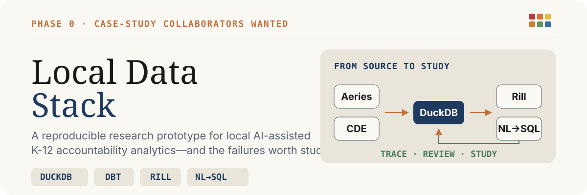
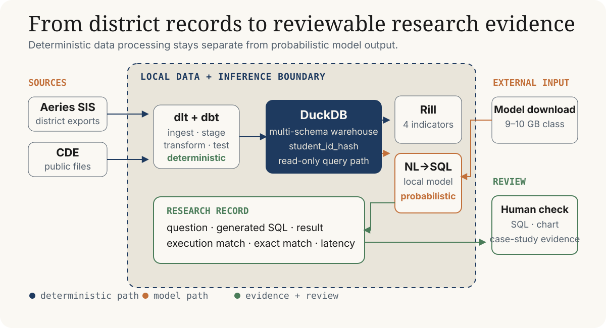

<p align="center">
  
</p>

<p align="center">
  <a href="https://research.lucidotechnologyconsulting.com/overview.html">Research overview</a> ·
  <a href="https://huggingface.co/datasets/KDDSTLC/lfed-lfm3-two-hop-trajectories">Two-hop data</a> ·
  <a href="https://huggingface.co/KDDSTLC/lfed-lfm3-1.7b-two-hop-bf16">LFM3-1.7B (bf16)</a> ·
  <a href="https://huggingface.co/KDDSTLC/lfed-lfm3-1.7b-two-hop-gguf">LFM3-1.7B (Q8_0 GGUF)</a> ·
  <a href="https://huggingface.co/spaces/KDDSTLC/LFED">Live demo</a> ·
  <a href="https://flucido.github.io/local-data-stack/diagrams/">Diagrams</a> ·
  <a href="#reproduce-locally">Reproduce locally</a>
</p>

> [!IMPORTANT]
> **Research status:** Local Data Stack (LFED) is a working research prototype in Phase 0—case-study preparation and collaborator search. The software artifacts are public; the district case study and K12-Bench study are planned. This repository is not presented as production-ready school software.

## The research case

Open K-12 analytics systems are difficult to study because district data is private, source systems are fragmented, and accountability metrics contain state-specific semantics. Local Data Stack provides an inspectable artifact for asking a narrower question: what changes when district administrators can query accountability data through an open, local-first stack—and where do the language-model components fail?

The first study is organized around three research questions:

1. **Adoption:** How do district administrators use a natural-language query layer to investigate accountability data?
2. **Failure modes:** Which accountability-semantic questions fail, and how do users detect or recover from plausible but incorrect SQL?
3. **Equity of access:** Does open-source natural-language tooling change who can ask district data questions?

Read the [60-second overview](https://research.lucidotechnologyconsulting.com/overview.html), [visual explainer](https://research.lucidotechnologyconsulting.com/explainer.html), [research synthesis](https://research.lucidotechnologyconsulting.com/synthesis.html), and [strategic pressures](https://research.lucidotechnologyconsulting.com/strategic-pressures.html).

## How the research artifact works

<p align="center">
  
</p>

- **Sources:** Aeries SIS exports and California Department of Education public files (24 download domains).
- **Deterministic path:** dlt loads Stage 1 schemas with a refresh-on-rebuild destination, dbt builds staging, privacy, core, feature, and analytics models, and the pipeline assembles a blue/green DuckDB file that replaces the live warehouse only after dbt tests pass.
- **Privacy boundary:** student identifiers become HMAC-SHA256 `student_id_hash` values; raw names, dates of birth, and contact fields are dropped after the encrypted re-identification lookup is built, cohorts below `k >= 5` are suppressed, and every query runs read-only behind schema/column allowlists and a DuckDB sandbox.
- **Interfaces:** Rill provides four California School Dashboard views; the Gradio app answers questions with the warehouse-schema NL-to-SQL model, and the desktop workspace runs the LFM3 two-hop loop locally.
- **Evidence:** the evaluation harness records execution match, exact match, Hop 2 validity, row counts, and mismatch samples per question. The legacy 20-prompt set writes `nl_query/traces_eval_test_set_<timestamp>.jsonl`; the 30-prompt two-hop holdout runs with `--two-hop`. Inspect or replicate traces before treating any generated SQL as authoritative.
- **Review:** generated SQL and charts require human review before operational use.

## Architecture diagrams

Five interactive views of the same system, generated from the code with every node and edge linked to the file and line it came from. Open the [diagram index](https://flucido.github.io/local-data-stack/diagrams/) in a browser.

| View | What it answers |
| --- | --- |
| [End-to-end data flow](https://flucido.github.io/local-data-stack/diagrams/dataflow-end-to-end.html) | How Aeries and CDE data become warehouse tables, dashboards, and answers |
| [NL-to-SQL query sequence](https://flucido.github.io/local-data-stack/diagrams/sequence-nl-sql-query.html) | What happens between a question and a result table, guard by guard |
| [Desktop two-hop hot path](https://flucido.github.io/local-data-stack/diagrams/sequence-desktop-two-hop.html) | How a typed question in the desktop app travels the Wry bridge, the two-hop agent loop, and zero-copy `arrow://` render |
| [Trust boundaries](https://flucido.github.io/local-data-stack/diagrams/architecture-trust-boundaries.html) | What stays on local hardware versus what crosses to Modal or the Hub |
| [Model and eval lifecycle](https://flucido.github.io/local-data-stack/diagrams/lifecycle-model-artifacts.html) | How the curated schema becomes two-hop trajectories, LFM3 builds, a desktop service, and the legacy rollback |

Source links are pinned to revision `2dd6750`. Each file in [`docs/diagrams/`](docs/diagrams) is standalone HTML with bundled fonts, so the diagrams also open offline without a server.

## Built now; studied next

### Available now

- **DuckDB Medallion Warehouse with a SQLite desktop tier**: A blue/green-built multi-schema DuckDB warehouse (`main_core`, `main_analytics`, `main_staging`, `main_privacy`, `main_privacy_sensitive`) fed by dlt and dbt; the desktop host keeps its bronze schools, students, attendance, snapshot summaries, and school-name overrides in `data/bronze_k12.db`.
- **Sovereign Local-First Desktop Engine (`desktop/`)**: Native Rust desktop host (Tao windowing + Wry webview) that snapshots the DuckDB warehouse, streams zero-copy Apache Arrow IPC record batches through the custom `arrow://` protocol, and enforces a CSP, navigation policy, loopback-only model endpoint, and SQL/schema allowlists.
- **Generative UI Component Registry (`desktop/ui/`)**: React 19 + TypeScript + Tailwind analytics workspace with a natural-language question box driving the two-hop agent loop (`run_prompt` IPC), TanStack tables, Recharts charts, and a zero-LLM filter bar that re-runs the cached query with parameterized filters. The registry ships six archetypes: `KPIGrid`, `TimeSeriesChart`, `CategoryBarChart`, `BudgetVarianceChart`, `DataTable`, and `FilterBar`.
- **Two-Hop Structured SLM (`LiquidAI/LFM3-1.7B`)**:
  - Full Fine-Tuning + execution-guided GRPO training pipeline on Modal A100 GPUs.
  - Published native bf16 weights: [`KDDSTLC/lfed-lfm3-1.7b-two-hop-bf16`](https://huggingface.co/KDDSTLC/lfed-lfm3-1.7b-two-hop-bf16).
  - Published calibrated Q8_0 GGUF: [`KDDSTLC/lfed-lfm3-1.7b-two-hop-gguf`](https://huggingface.co/KDDSTLC/lfed-lfm3-1.7b-two-hop-gguf) (calibrated with `llama-imatrix`).
  - Published training trajectory dataset: [`KDDSTLC/lfed-lfm3-two-hop-trajectories`](https://huggingface.co/datasets/KDDSTLC/lfed-lfm3-two-hop-trajectories).
  - The desktop host calls a loopback `llama-server` at `http://127.0.0.1:8080` by default (`LFED_SLM_ENDPOINT`) and falls back to a deterministic keyword backend when no server is running.
- **Four Rill Dashboards**: Aligned to California School Dashboard indicators (Chronic Absenteeism, Suspension, Academic ELA, ELPI).
- **Evaluation Suites**: A 30-prompt held-out two-hop benchmark (`nl_query/eval_two_hop_holdout.jsonl`), the legacy 20-prompt NL-to-SQL development set, Rust contract tests, a React Vitest suite, and Python pipeline/guard tests. GitHub Actions runs Python, dbt smoke, React, and Rust jobs.

### Planned research

- A supervised 30-day district case study with usage-log analysis and semi-structured interviews.
- A case-study paper on adoption, failure modes, and equity of access.
- K12-Bench: a planned 220-prompt, multi-model accountability-metric reasoning benchmark.

## Sovereign Local-First Desktop & Generative UI Engine

Local Data Stack includes a native, air-gapped desktop application engineered for zero-latency district data analysis without sending student or institutional data to external cloud APIs.

```mermaid
flowchart TD
    User["District Administrator / User"] -->|Natural Language Query| UI["React 19 Generative UI Workspace"]
    UI -->|IPC Request| Rust["Rust Desktop Host (Tao + Wry)"]
    Rust -->|Top-5 Tables (<800 tokens)| Pruner["BM25 Schema Pruner + Sample Values"]
    Pruner -->|Pruned DDL + Question| SLM["Loopback llama-server (LFM3 Q8_0 GGUF)"]
    SLM -->|Hop 1: SQL Generation| Engine["DuckDB Analytical Engine"]
    Engine -->|Execution Feedback / Self-Healing| SLM
    SLM -->|Hop 2: GenUI Payload JSON| UI
    Engine -->|Apache Arrow IPC RecordBatch| IPC["Custom arrow:// Streaming Protocol"]
    IPC -->|Zero-Copy Arrow Bytes| UI
    UI -->|Render Archetype| Reg["Component Registry (KPIGrid, TimeSeriesChart, CategoryBarChart, BudgetVarianceChart, DataTable, FilterBar)"]
    Reg -->|Client-side Slider Scrubbing| Engine
```

When no loopback model is available, the host falls back to a deterministic keyword backend so preset scenarios and UI work remain testable without a model.

### 1. Dual-Database Embedded Medallion Architecture
- **Bronze Tier (SQLite ACID)**: The desktop host keeps its bronze schools, students, attendance, snapshot summaries, and school-name overrides in `data/bronze_k12.db` with full transactional integrity.
- **Silver & Gold Tiers (DuckDB Columnar)**: `oss_framework/data/analytics.duckdb` houses the dimensional and fact tables, and `training/training_schema.json` exposes 20 curated tables across `main_core`, `main_analytics`, and `main_staging` to the model. The desktop host copies the warehouse to a temporary read-only snapshot per session so pipeline rebuilds do not block queries.
- **Zero-Copy Arrow Streaming Protocol**: Results are returned over a custom `arrow://` IPC scheme. The Rust host reads columnar DuckDB RecordBatches directly into Arrow IPC byte buffers, enabling the React webview to consume Arrow Tables without JSON serialization overhead or memory thrashing.

### 2. Two-Hop Tool Calling Protocol
1. **Hop 1 — SQL Formulation & Validation**:
   - The user's natural language question is combined with dynamic schema context: a deterministic BM25 + foreign-key pruner selects the five most relevant tables and formats them to roughly 800 tokens. The desktop host then grounds categorical and year columns (`academic_year`, `reporting_category`, `primary_race`, and similar) with up to eight live values read from the warehouse, so the DDL uses real codes (`main.rs` → `enrich_schema_catalog`, `training/schema_pruner.py` / `schema_pruner.rs`).
   - The model generates DuckDB SQL under a GBNF grammar.
   - **Hop 1b Self-Healing Loop**: If execution encounters catalog, type, or syntax errors, the DuckDB `Candidate bindings` trace is fed back into the model for immediate self-correction (up to two retries).
2. **Hop 2 — Generative UI Synthesis**:
   - The verified SQL result schema and question are supplied to the model to produce a typed `render_workspace_ui` payload.
   - The model selects a visual archetype from the registry (`KPIGrid`, `TimeSeriesChart`, `CategoryBarChart`, `BudgetVarianceChart`, `DataTable`, `FilterBar`), binds output columns, and validates every binding against the Hop 1 result columns before mount.
3. **Zero-LLM Filter Re-Execution**:
   - Analytical queries are formulated using `WITH _base AS (...)` Common Table Expressions with exposed filter parameters.
   - The React UI generates interactive filter controls (threshold sliders, category multi-selects, date pickers).
   - When a human user moves a slider, DuckDB re-executes the parameterized query locally without calling the language model; the UI reports the observed filter latency.

### 3. Model Training & Quantization (`LiquidAI/LFM3-1.7B`)
- **Architecture**: `LiquidAI/LFM3-1.7B` native architecture optimized for structured tool calling and compact memory footprint.
- **Training Recipe**:
  - Full Fine-Tuning in `bfloat16` on 3,000 verified multi-schema K-12 trajectory pairs (2,100 golden, 450 self-healing, 450 follow-up) on Modal A100-80GB GPUs.
  - Execution-guided Group Relative Policy Optimization (GRPO) scored by `training/reward_fn.py`: Hop 1 rewards valid tool JSON, clean execution, and exact result-set match (multiset comparison) while penalizing malformed or failing SQL; Hop 2 rewards valid column bindings and semantically appropriate chart choice.
- **Quantization & llama.cpp Metal Offload**:
  - Exported to `Q8_0` GGUF calibrated with `llama-imatrix` on domain-specific K-12 SQL and GenUI grammar datasets.
  - The ~1.8 GB file fits completely within unified memory on Apple Silicon (M1/M2/M3/M4) and executes with 100% Metal GPU layer offload via `llama-server`.

---

## Interactive Human Test Environment

This guide is designed for a human operator sitting down at the machine to explore, query, and evaluate the system naturally.

### Mode 1: Native Desktop Application (Full Sovereign Experience)
Launch the compiled native desktop application:
```bash
cargo run --manifest-path desktop/Cargo.toml
```
- **What opens**: A native OS window powered by `tao` and `wry`.
- **Under the hood**: The Rust host opens the SQLite bronze store (`data/bronze_k12.db`), snapshots the DuckDB warehouse (`oss_framework/data/analytics.duckdb`) read-only, registers the custom `arrow://` IPC scheme with a restrictive CSP and navigation policy, and renders the compiled React webview.
- **How to test as a human**:
  1. Type a plain-English question in the **Ask a question** box and press **Get answer** (⌘/Ctrl+Enter also works). The question travels over the Wry IPC bridge (`run_prompt`) into the two-hop agent loop; results render through the same Generative UI registry as the presets. Free-text asking requires the native host — the Vite dev server explains that and leaves the preset reports available.
  2. Browse the pre-loaded starter reports (Multi-Year School Enrollment, Equity Outcomes by Race, CDE Subgroup Accountability).
  3. Inspect the generated KPI summaries and interactive visual charts.
  4. Scrub the filter bar (academic-year range, school or subgroup selectors, numeric ranges) to re-run the cached query without a model call; the UI reports the measured filter latency.
  5. Open **Show technical details** to inspect the Hop 1 tool call and SQL, the result summary, and the Hop 2 layout specification.

If `llama-server` is running on the default endpoint, the host uses it. If it is not reachable, the host shows a **Demo Mode** badge and answers with the deterministic keyword backend.

For a scored, section-by-section human test script, see [`desktop/HUMAN_TEST_PLAN.md`](desktop/HUMAN_TEST_PLAN.md).

### Mode 2: Web Developer Workspace (Vite Dev Server)
If you are iterating on the frontend UI, tweaking component archetypes, or testing responsive layouts:
```bash
cd desktop/ui
npm install
npm run dev
```
- Open `http://localhost:5173` in any modern browser.
- Provides seeded preset datasets, real-time component hot reloading, and TanStack table sorting/filtering controls.

### Mode 3: Local SLM Inference (`llama-server`)
To run the calibrated ~1.8 GB Small Language Model locally on Apple Silicon Metal or CPU:
```bash
# Verify the quantized GGUF artifact is present in models/:
ls -lh models/lfed-lfm3-1.7b-two-hop-Q8_0.gguf

# Start the high-performance llama.cpp server with Metal GPU offload:
llama-server -m models/lfed-lfm3-1.7b-two-hop-Q8_0.gguf -ngl 99 --port 8080
```
- The desktop host calls `http://127.0.0.1:8080/completion` by default; override it with `LFED_SLM_ENDPOINT` (loopback hosts only).
- The host sends the GBNF grammar with each request: `training/grammars/hop1_sql.gbnf` for Hop 1 and a dynamically compiled grammar from `compile_hop2_gbnf(output_columns)` for Hop 2, so tool calls stay syntactically valid.

### Running Automated Test Suites
To verify all engine contracts before human testing:
```bash
# 1. Rust Desktop Host, IPC, sandbox, and agent-loop tests
cargo test --manifest-path desktop/Cargo.toml

# 2. React UI Vitest suite
npm --prefix desktop/ui run test

# 3. Python two-hop foundation, guard, and pipeline tests
uv run pytest nl_query/tests oss_framework/tests -q
```

## Reproduce locally

### Prerequisites

- Python 3.12 or 3.13.
- `uv` for dependency installation and command execution.
- The Rill CLI for dashboard development.
- Node 22+ for the desktop TypeScript UI, and a Rust toolchain for the desktop host.
- Network access for dependencies and Hugging Face model downloads.
- About 1.8 GB for the LFM3 Q8_0 GGUF used by the desktop host; the legacy Qwen r=64 Gradio path needs roughly 9–10 GB plus runtime headroom.
- Aeries/CDE source data for a full district reproduction. The included five-row Parquet sample is useful for inspection, but it does not reproduce district results.

### 1. Install the framework

```bash
git clone https://github.com/flucido/local-data-stack.git
cd local-data-stack
uv sync --extra dev
cp .env.example .env
```

Configure `.env` with Aeries credentials or local source settings before running source-dependent pipelines. The privacy layer refuses to build without secrets, so generate and set at least:

- `PII_SALT`: 16+ random characters; keys the HMAC-SHA256 identity hashes and must stay stable across rebuilds.
- `PII_ENCRYPTION_KEY`: a 32+ character secret; derives the AES-256-GCM key for the break-glass lookup table.
- `LFED_STUDENT_SALT` and `LFED_STAFF_SALT`: 16+ random characters each; used only by `scripts/anonymize_aeries.py` for offline CSV anonymization. Set `LFED_STUDENT_SALT` equal to `PII_SALT` when the offline hashes must join to the dbt-built hashes.

The pipeline does not load `.env` itself. Export it into the shell before dbt or the pipeline:

```bash
set -a
. ./.env
set +a
```

### 2. Inspect the public sample

The repository includes `oss_framework/data/sample_data/synthetic_student_metrics.parquet`, a five-row synthetic student sample for inspecting downstream columns. The [Hugging Face training dataset](https://huggingface.co/datasets/KDDSTLC/lfed-training-data) contains synthetic question/SQL pairs for model training; it is not a replacement for warehouse source data.

### 3. Build the DuckDB warehouse

```bash
set -a; . ./.env; set +a
cd oss_framework/dbt
uv run dbt deps
DBT_PROFILES_DIR=. uv run dbt parse
DBT_PROFILES_DIR=. uv run dbt build
cd ../..
```

Or run the full orchestrated pipeline from the repository root, which builds into a blue/green file and replaces `oss_framework/data/analytics.duckdb` only after the stages and dbt tests pass:

```bash
set -a; . ./.env; set +a
uv run python scripts/run_pipeline.py
```

The complete build depends on the configured Aeries/CDE inputs. Do not treat a successful clone as a reproduced district deployment.

### 4. Launch the Rill dashboards

```bash
cd rill_project
rill start
cd ..
```

### 5. Run the NL-to-SQL app

The Gradio app is the single-hop legacy interface. It selects a backend automatically:

| Hardware | Backend | Model path |
| --- | --- | --- |
| CUDA GPU | transformers + PEFT | 4-bit Qwen2.5-Coder-14B base plus the r=64 LoRA adapter |
| Apple Silicon | llama.cpp + Metal | Local warehouse r=64 GGUF; public Hub fallback is older v1 |
| CPU | llama.cpp | Local warehouse r=64 GGUF; public Hub fallback is older v1 and slower |

Override selection with `LFED_BACKEND=transformers` or `LFED_BACKEND=llamacpp`.

```bash
uv sync --extra dev --extra nl-query
uv run hf download KDDSTLC/lfed-qwen2.5-coder-14b-sql-lora-warehouse-r64 --local-dir models/lora-warehouse-r64
set -a; . ./.env; set +a
cd nl_query
uv run python -m app
cd ..
```

The CUDA path uses `unsloth/qwen2.5-coder-14b-instruct-bnb-4bit` plus the r=64 LoRA adapter. The Apple Silicon/CPU resolver checks `LFED_GGUF_PATH`, then `models/lfed-qwen2.5-coder-14b-sql-warehouse-r64-Q4_K_M.gguf`, then falls back to `KDDSTLC/lfed-qwen2.5-coder-14b-sql-gguf`, the older v1 five-table model. Use the local warehouse-r64 GGUF when evaluating the current schema. Model download happens before inference becomes local.

The two-hop LFM3 path used by the desktop app and by `nl_query.eval --two-hop` is documented in Mode 3 above. The desktop host is the primary two-hop surface.

> **Why two backends?** The 4-bit transformers base was chosen for Hugging Face Spaces ZeroGPU, where GPU access is CUDA/PyTorch-based. bitsandbytes 4-bit inference does not support Apple Silicon. On macOS, a merged Q4_K_M GGUF uses llama.cpp with Metal and is designed to fit within a 16 GB machine; the warehouse-r64 GGUF must be supplied locally because the public Hub GGUF is the older v1 fallback.

### 6. Run the evaluation harness

```bash
set -a; . ./.env; set +a
cd nl_query

# Legacy 20-prompt single-hop development set
uv run python eval.py --test-set eval_test_set.jsonl --adapter ../models/lora-warehouse-r64

# 30-prompt held-out two-hop set (Top-K pruning, GBNF, self-healing, Hop 2 validation)
uv run python eval.py --test-set eval_two_hop_holdout.jsonl --two-hop
cd ..
```

Each run writes per-question JSONL traces next to the test set (`traces_<test-set>_<timestamp>.jsonl`) unless `--traces` overrides the path. The repository does not publish an accuracy figure until a complete trace run is verified.

## Public artifacts

| Artifact | Link | Role |
| --- | --- | --- |
| LFM3 Two-Hop Trajectories | [KDDSTLC/lfed-lfm3-two-hop-trajectories](https://huggingface.co/datasets/KDDSTLC/lfed-lfm3-two-hop-trajectories) | 3,000 multi-schema K-12 two-hop training trajectories (Hop 1 SQL + Hop 2 GenUI) |
| LFM3-1.7B Two-Hop (bf16) | [KDDSTLC/lfed-lfm3-1.7b-two-hop-bf16](https://huggingface.co/KDDSTLC/lfed-lfm3-1.7b-two-hop-bf16) | Native bf16 SFT + execution-guided GRPO model |
| LFM3-1.7B Two-Hop (Q8_0 GGUF) | [KDDSTLC/lfed-lfm3-1.7b-two-hop-gguf](https://huggingface.co/KDDSTLC/lfed-lfm3-1.7b-two-hop-gguf) | Calibrated Q8_0 GGUF with `llama-imatrix` for local Apple Silicon / CPU |
| Legacy Training data | [KDDSTLC/lfed-training-data](https://huggingface.co/datasets/KDDSTLC/lfed-training-data) | 25,886 synthetic NL-to-SQL pairs |
| Legacy Qwen adapter | [KDDSTLC/lfed-qwen2.5-coder-14b-sql-lora-warehouse-r64](https://huggingface.co/KDDSTLC/lfed-qwen2.5-coder-14b-sql-lora-warehouse-r64) | Warehouse-schema r=64 LoRA |
| Legacy Qwen GGUF | [KDDSTLC/lfed-qwen2.5-coder-14b-sql-gguf](https://huggingface.co/KDDSTLC/lfed-qwen2.5-coder-14b-sql-gguf) | Older v1 five-table llama.cpp fallback |
| Live interface | [KDDSTLC/LFED](https://huggingface.co/spaces/KDDSTLC/LFED) | Hosted Gradio demonstration |

The earlier r=32 adapter remains available as a rollback and comparison artifact at [KDDSTLC/lfed-qwen2.5-coder-14b-sql-lora](https://huggingface.co/KDDSTLC/lfed-qwen2.5-coder-14b-sql-lora).

## Evaluation boundaries and known failure modes

The harness reports execution match, exact match, and Hop 2 layout validity over two sets: a 20-question single-hop development set and a 30-question held-out two-hop set. It does not yet represent the planned K12-Bench study.

Research-relevant failure modes include:

- **Year formats:** CDE commonly uses `2023-24`; Aeries-derived data may use `2023-2024`; joins span multiple academic years.
- **Suppression:** CDE cells marked `is_suppressed` or below the small-n threshold must not be treated as ordinary observations; analytics marts and exports also suppress cohorts below `k >= 5`.
- **Reporting categories:** natural-language group names do not always map directly to CDE category codes.
- **Schema drift:** the model only sees the five pruned tables, so a question that needs an unpruned table can produce valid SQL against the wrong slice.
- **Plausible SQL:** a query can execute and return a credible chart while still answering the wrong question.
- **Chart choice:** a valid Hop 2 payload can still bind columns to a misleading archetype; the eval scores Hop 2 validity separately from chart suitability.
- **Rill semantics:** the model generates raw DuckDB SQL directly against the analytical tables rather than Metrics SQL against Rill metrics views.

## California School Dashboard coverage

| Indicator | Source pattern | Grades | Goal direction |
| --- | --- | --- | --- |
| Chronic Absenteeism | `chronicdownloadYYYY.txt` | TK–8 | Lower is better |
| Suspension Rate | `suspdownloadYYYY.txt` | TK–12 | Lower is better |
| Academic—ELA | `eladownloadYYYY.txt` | 3–8, 11 | Higher is better |
| English Learner Progress | `elpidownloadYYYY.txt` | 1–12 | Higher is better |

Each view carries CDE-provided Status, Change, and Performance Color values from the state’s 5×5 Status × Change grid. See the [2025 Dashboard Technical Guide](https://www.cde.ca.gov/ta/ac/cm/dashboardguide.asp).

## Participate in the case study

The project is looking for:

- **Research co-authors** who can shape the methodology and failure-mode analysis.
- **Reviewers or methods advisors** who can challenge the research questions and study design.
- **Supervised district partners** who can evaluate the workflow and document where it helps or fails.

[Open a case-study collaboration issue](https://github.com/flucido/local-data-stack/issues/new) and include your role, organization type, intended use, data environment, and desired level of involvement. Opening an issue does not guarantee onboarding, deployment support, authorship, or participation.

## Technical reference

<details>
<summary>Repository layout</summary>

```text
local-data-stack/
├── desktop/             # Rust desktop host (Tao+Wry), SQL/Arrow IPC, and React 19 UI
├── oss_framework/       # dlt, dbt, DuckDB, orchestration, tests
├── nl_query/            # Gradio app, inference backends, SQL guard, evaluation
├── training/            # Two-hop trajectory generation, SFT + GRPO, GGUF export
├── rill_project/        # Metrics, dashboards, models, alerts, APIs
├── models/              # Local model instructions and calibrated GGUF weights
├── research/            # Research explainer source
├── scripts/             # Root orchestration, anonymization, and contracts
├── docs/                # Research specs, audits, and generated diagrams
├── data/                # Local source data and the desktop bronze store
└── assets/              # README images
```

</details>

<details>
<summary>Model training</summary>

`training/` carries two tracks. The desktop path is the LFM3 two-hop track: `modal_generate.py` builds verified multi-turn trajectories, `modal_train_slm.py` runs bf16 full fine-tuning plus execution-guided GRPO, and `modal_export_gguf.py` produces the calibrated Q8_0 GGUF. The legacy Qwen track (`generate_pairs.py`, `modal_generate.py`, and QLoRA training) remains for the Gradio app and rollback artifacts. See [`training/README.md`](training/README.md) and [`models/README.md`](models/README.md).

```bash
# Legacy local pair generation / Modal generation
python training/generate_pairs.py --n 5000 --output training/pairs.jsonl --dry-run
modal run --detach training/modal_generate.py

# LFM3 two-hop training and export run on Modal and publish to the Hub
modal deploy training/modal_train_slm.py
modal run training/modal_export_gguf.py
```

</details>

### Validation

The commands below match the GitHub Actions jobs. Export the privacy variables first, because dbt parses `PII_SALT` and the privacy models need `PII_ENCRYPTION_KEY`.

```bash
set -a; . ./.env; set +a

# Python: pipeline, sanitization, NL guard, and two-hop tests
uv run pytest oss_framework/tests nl_query/tests -q

# Dashboard contracts against a throwaway warehouse
DUCKDB_DATABASE_PATH=/tmp/lfed_contracts.duckdb uv run python scripts/contracts/contract_tests.py

# Lint and format (CI covers scripts/ and training/ too)
uv run ruff check oss_framework nl_query scripts training
uv run black --check oss_framework nl_query scripts training
uv run mypy oss_framework

# Desktop host and UI
cargo test --manifest-path desktop/Cargo.toml
npm --prefix desktop/ui run test
npm --prefix desktop/ui run build
```

## Project policies

- [Contributing](CONTRIBUTING.md)
- [Security](SECURITY.md)
- [Code of Conduct](CODE_OF_CONDUCT.md)

## License

- Source code and materials: [MIT License](LICENSE)
